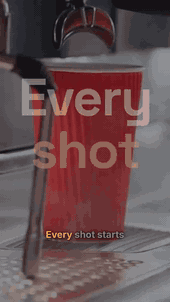

<p align="center"></p>

<h1 align="center">UberScene</h1>

<p align="center">
  <b>A React library for making videos and building editors around them.</b>
</p>

<p align="center">
  <a href="https://github.com/prefix-tree/uberscene/actions/workflows/ci.yml"></a>
  <a href="https://www.npmjs.com/package/uberscene"></a>
  <a href="https://cutcraft.prefixtree.xyz/"></a>
  <a href="https://github.com/prefix-tree/uberscene/actions/workflows/codeql.yml"></a>
  <a href="LICENSE"></a>
  
</p>

<p align="center">
  <a href="https://cutcraft.prefixtree.xyz/">Documentation</a> ·
  <a href="https://cutcraft.prefixtree.xyz/examples">Examples</a> ·
  <a href="https://cutcraft.prefixtree.xyz/guide/introduction">Guide</a> ·
  <a href="https://cutcraft.prefixtree.xyz/reference/elements/">Reference</a> ·
  <a href="CHANGELOG.md">Changelog</a>
</p>

---

**TL;DR** UberScene is a React library for making videos and building editors around them.

It covers multitrack composition, captions, audio, transitions, effects, and your own Motion or three.js graphics,
plus a browser player and a CLI export. MIT, no paid tier, no watermark.

## Why not Remotion or HyperFrames?

Both are good at turning code into video.

1. Remotion is React, but it isn't MIT: companies need a paid licence.
2. HyperFrames is open source, but it's built around HeyGen's CLI and Studio app.

UberScene is a library you can build an editor on. An agent writes the TSX, and a person previews and adjusts the same
video visually. Edits have undo/redo and are written back to the source as the smallest text change.

It also times things by words and shots instead of seconds, and lets a model check a cut without watching it:
timeline inspection, contact sheets and layout checks.

<p align="center">
  
</p>
<p align="center">
  
  
  
</p>
<p align="center"><sub>Each is one TSX file. <a href="https://cutcraft.prefixtree.xyz/examples">See them next to their code</a>.</sub></p>

## Examples

### A cut on words and shots

```tsx
export default function Video() {
  return (
    <Composition fps={30} width={1920} height={1080}>
      <Track id="main">
        <Clip id="hook" src="asset:founder" in="word:12" out="word:23.end" />
        <Transition id="x1" type="crossfade" duration={0.4} />
        <Clip id="broll" src="asset:product" in="shot:1" out="shot:1.end" fit="cover" />
      </Track>
      <Track id="overlays">
        <Title id="title" anchor="hook" at="word:14" duration={2.8}>Shed</Title>
      </Track>
      <Track id="music" layout="free">
        <Audio id="bed" src="asset:music" start={0} duration="fill" volume={0.35} duck={{ under: "main", to: 0.15 }} />
      </Track>
    </Composition>
  );
}
```

Drag the end of `hook` in the timeline and one token in the file changes. The b-roll moves up, the title stays on its
word, and the music still runs to the end.

### Captions, effects and transitions

```tsx
<Captions id="captions" src="asset:founder" style={{ position: "bottom", size: 44 }} animation="karaoke" />

<Clip id="interview" src="asset:interview">
  <Effect id="expose" type="exposure" params={{ stops: 0.5 }} />
  <Effect id="key" type="colorKey" params={{ color: "#18c43a", tolerance: 0.3 }} />
</Clip>
<Transition id="x2" type="iris" duration={0.8} params={{ sides: 5, star: 0.45 }} />
```

### three.js, Motion or any React

```tsx
<Three id="cube" anchor="hook" at="word:14" duration={4}
  setup={({ scene, THREE }) => {
    const cube = new THREE.Mesh(new THREE.BoxGeometry(), new THREE.MeshNormalMaterial());
    scene.add(cube);
    return ({ time }) => { cube.rotation.set(time * 0.6, time, 0); };
  }}
/>

<Layer id="card" anchor="hook" at="word:20" duration={3}>
  <FlipCard front="Before" back="After" />   {/* your own component */}
</Layer>
```

Everything runs on the video's clock, so scrubbing, seeking and export show the exact frame.

### Check a cut without watching it

```
$ npx uberscene inspect video.tsx
video.tsx  1920x1080  30 fps  25.60 s (768 frames)  0 errors
track main (sequence)
     0.00–5.20     clip        hook  asset:founder 5.60–10.80  words 12–23 "Small software still deserves a real cloud It s…"
     4.80–5.20     transition  x1  crossfade (hook → broll)
     4.80–10.80    clip        broll  asset:product 6.00–12.00

$ npx uberscene look video.tsx --out look.png     # a contact sheet of the frames worth seeing
```

## Quick start

```sh
npm install uberscene @uberscene/kit react zod
npx uberscene hello.tsx --out hello.mp4
```

The [guide](https://cutcraft.prefixtree.xyz/guide/getting-started) starts with a video that needs no footage. For
coding agents there is an [Agent Skill](plugins/uberscene): `/plugin marketplace add prefix-tree/uberscene`.

## Packages

| Package | What it is |
|---|---|
| [`uberscene`](packages/cli) | CLI: export, inspect, contact sheets, layout checks. |
| [`@uberscene/kit`](packages/kit) | Elements, timing, editor actions with undo, write-back to source. |
| [`@uberscene/player`](packages/player) | Browser player and React `<Player>`. |
| [`@uberscene/render`](packages/render) | Export as a library. |
| [`@uberscene/graphics`](packages/graphics) | three.js and Motion on the video's clock. |

## Feedback

I'd like to hear what you think of the format and what's missing. Open an
[issue](https://github.com/prefix-tree/uberscene/issues). See [CONTRIBUTING.md](CONTRIBUTING.md) to contribute.

## License

[MIT](LICENSE).
