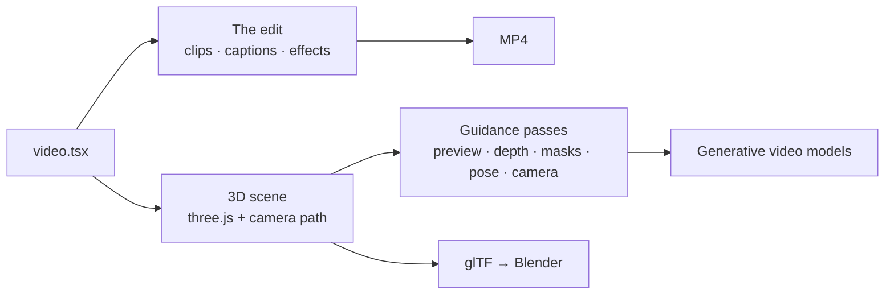

<p align="center"></p>

<h1 align="center">UberScene</h1>

<p align="center">
  <b>A whole multimedia pipeline written as code.</b>
</p>

<p align="center">
  <a href="https://github.com/prefix-tree/uberscene/actions/workflows/ci.yml"></a>
  <a href="https://www.npmjs.com/package/uberscene"></a>
  <a href="https://uberscene.prefixtree.xyz/"></a>
  <a href="https://github.com/prefix-tree/uberscene/actions/workflows/codeql.yml"></a>
  <a href="LICENSE"></a>
  
</p>

<p align="center">
  <a href="https://uberscene.prefixtree.xyz/">Documentation</a> ·
  <a href="https://uberscene.prefixtree.xyz/examples">Examples</a> ·
  <a href="https://uberscene.prefixtree.xyz/guide/introduction">Guide</a> ·
  <a href="https://uberscene.prefixtree.xyz/reference/elements/">Reference</a> ·
  <a href="CHANGELOG.md">Changelog</a>
</p>

---

> [!WARNING]
> **Work in progress.** UberScene is early. The API is still being shaped and changes between releases, often in
> breaking ways, and will keep changing until 1.0. Each release's changelog says how to move a file, and
> `uberscene lint --fix` moves most of it for you.

UberScene is a React library for making videos and building editors around them. One TSX file is the video: clips,
captions, audio, transitions, effects, and any React, Motion or three.js on top. Play it in the browser, adjust it on a timeline, export it to MP4.

## Why

- **A video is a file.** Diff it, review it in a pull request, generate a hundred variants.
- **Models write code, not math.** Cuts name a transcript word or a camera shot (`in="word:12"`), not seconds, and
  UberScene works out every frame.
- **One file, every editor.** Your agent edits the text, you edit on a timeline; both change the same file, with undo.
- **No FFmpeg.** The export draws and encodes in headless Chrome, with nothing else to install.
- **MIT.** No paid tier, no watermark.

### Native codecs (experimental)

UberScene can also decode footage and encode the export with its own codecs, written in Rust on FilmCraft's
[craft-video, craft-media and craft-audio](https://github.com/storytold/craft-libs). They decode H.264, HEVC, VP8,
VP9, AV1, ProRes and DNxHR, and encode H.264, ProRes and the soundtrack, still with no FFmpeg and no C libraries. They
are off unless `UBERSCENE_CODECS` turns them on, are built from source for now, and Chrome stays the default.
[Native codecs](https://uberscene.prefixtree.xyz/guide/native-codecs) has the details.

## Aim

Agents work better with code than with ffmpeg flags or a mouse, so the video, its graphics and its 3D scenes all live
in one file.



A rough 3D render is one of the most precise ways to pin down camera and layout for video models. So the same file
that cuts your video should also render what those models take, frame for frame on the same timeline.

| | Roadmap |
|---|---|
| ✅ | Editing as code: tracks, captions, audio, transitions, effects, React, Motion and three.js layers |
| ✅ | One file, every editor: agent edits and timeline edits write back to the same source |
| 🚧 | 3D scenes with a camera path on the video's clock |
| 🔜 | Guidance passes: shaded preview, depth, masks, pose skeletons, per-frame camera |
| 🔜 | glTF export, so the scene opens in Blender |

## Install

```sh
npm install uberscene @uberscene/kit react zod
```

Then give your agent the skill that lets it make and edit videos. In Claude Code:

```
/plugin marketplace add prefix-tree/uberscene
/plugin install uberscene@prefix-tree
```

For any other agent: `npx uberscene skills install`. Then brief it like an editor: *"Cut a 30 second vertical clip
from talk.mp4, open on the sentence about Fridays, add karaoke captions, render to video.mp4."*

Guide, reference and examples: **[uberscene.prefixtree.xyz](https://uberscene.prefixtree.xyz/)**.

## Example

<p align="center">
  
</p>

```tsx
export default function Video({ product, founder, accent }) {
  return (
    <Composition fps={30} width={960} height={540}>
      <Track id="main">
        <Clip id="talk" src="asset:founder" in="word:0" out="word:11.end" fit="cover" />
        <Transition id="x1" type="crossfade" duration={0.4} />
        <Clip id="broll" src="asset:product" in={0} out={1.6} fit="cover" />
        <Transition id="x2" type="crossfade" duration={0.4} />
        <Clip id="close" src="asset:founder" in="word:12" out="word:25.end" fit="cover" />
      </Track>
      <Track id="device" layout="free">
        <Three id="phone" anchor="talk" at="word:1" duration={12} setup={phoneScene} />
      </Track>
      <Track id="text" layout="free">
        <Motion id="sandbox" anchor="close" at="word:17" duration={2.4}
          sequence={[[".pill", { opacity: [0, 1], x: [-40, 0] }]]}>
          <div className="pill">Every app in a sandbox</div>
        </Motion>
      </Track>
    </Composition>
  );
}
```

Trim `talk` and every callout moves with its word. Full file: [`examples/showcase/launch.tsx`](examples/showcase/launch.tsx).

## License

[MIT](LICENSE). Feedback and ideas welcome in [issues](https://github.com/prefix-tree/uberscene/issues).
