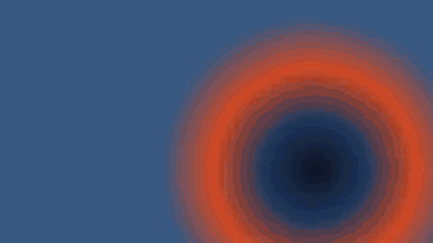
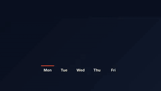

<p align="center"></p>

<h1 align="center">CutCraft</h1>

<p align="center">
  <b>Video editor as code.</b><br>
  LLMs are good at writing code and bad at math: the model writes the video as a TSX file that names words and shots,
  and CutCraft does the arithmetic. The browser plays the file, an editor edits it, and Node exports it.
</p>

<p align="center">
  <a href="https://github.com/prefix-tree/cutcraft/actions/workflows/ci.yml"></a>
  <a href="https://prefix-tree.github.io/cutcraft/"></a>
  <a href="LICENSE"></a>
  
</p>

<p align="center">
  <a href="https://prefix-tree.github.io/cutcraft/">Documentation</a> ·
  <a href="https://prefix-tree.github.io/cutcraft/examples">Examples</a> ·
  <a href="https://prefix-tree.github.io/cutcraft/guide/writing-files">Writing a file</a> ·
  <a href="https://prefix-tree.github.io/cutcraft/reference/elements">Reference</a> ·
  <a href="docs/decisions/README.md">Decisions</a> ·
  <a href="CHANGELOG.md">Changelog</a>
</p>

---

There is no project document beside the file, no tool catalog for the model, and no second renderer for export: the
same engine that plays the file in the browser exports it to video, headless, in Node.

```tsx
export const schema = z.object({ product: z.string(), accent: z.string() });
export const defaults = { product: "Shed", accent: "#ff5a1f" };

export default function Video({ product, accent }: z.infer<typeof schema>) {
  return (
    <Composition fps={30} width={1920} height={1080}>
      <Track id="main">
        <Clip id="hook" src="asset:founder" in="word:12" out="word:23.end" />
        <Transition id="x1" type="crossfade" duration={0.4} />
        <Clip id="broll" src="asset:product" in="shot:1" out="shot:1.end" fit="cover" />
      </Track>
      <Track id="overlays">
        <Title id="title" anchor="hook" at="word:14" duration={2.8} color={accent}>{product}</Title>
      </Track>
      <Track id="music" layout="free">
        <Audio id="bed" src="asset:music" start={0} duration="fill" volume={0.35} duck={{ under: "main", to: 0.15 }} />
      </Track>
    </Composition>
  );
}
```

Drag the end of `hook` in the timeline and the file changes by one token. The b-roll moves with it, the title stays on
the word it was timed to, the bed still fills to the end. The model reads the new file and sees what you did.

<p align="center">
  
</p>
<p align="center">
  
  
  
</p>
<p align="center"><sub>Each is one short TSX file rendered by CutCraft's export engine: an edit, data graphics, a spring-driven chart, and a vertical short with captions. <a href="https://prefix-tree.github.io/cutcraft/examples">See them with their files</a>.</sub></p>

## Why

Models are good at writing code and bad at math and at driving a hundred tools. A cut written as seconds the model
computed lands inside a word; a cut written as `word:12` lands on it. Editors are good at direct manipulation and
bad at explaining themselves to a model. CutCraft puts both on one artifact: a file in a fixed vocabulary with literal ids, so
a gesture can find its element and change one value, and a model can read the result as the code it wrote. The reasoning
behind each choice is in the [decision records](docs/decisions/README.md).

## How it works

```
file.tsx ──evaluate──▶ element tree ──collect──▶ CollectedTree ──resolve(manifest, patches)──▶ ResolvedState ──▶ Player
   ▲                                                                                              │
   └── fold(patch log) ◀── Executor.execute(action) ◀── timeline / inspector / preview gestures ◀──┘
```

- **Vocabulary.** 27 elements with Zod schemas: tracks (magnetic sequence or free), clips trimmed by seconds or by
  transcript words and shots, transitions, titles, shapes, SVG, stickers, built-in graphics, captions, markers,
  adjustment layers, masks, nested compositions, multicam, keyframes, speed ramps, effects, and `<Layer>` for arbitrary
  React.
- **Time by meaning.** `in="word:12"`, `out="shot:3.end"`, and overlays timed to a word of the clip that says it
  (`anchor="hook" at="word:14"`), so cuts and graphics follow every trim.
- **Resolver.** Places everything from the file, the asset manifest and the patch log. Typed errors, memoised, about
  1 µs per element per change.
- **Actions.** 131 editor actions, each with `validate`, `apply`, `invert` and `fold`; history with gesture grouping;
  every action undoes.
- **Source tools.** A source index, a fold that writes patches back as token edits, a bake for generated elements, and
  a lint for the file contract that reports anything accepted but not drawn.
- **Player.** WebCodecs decoding through [mediabunny](https://mediabunny.dev), one canvas for footage, DOM for overlays,
  Web Audio as the clock and mixer, a deterministic `seekTo(t)`, a React `<Player>` and a framework-free `PlayerCore`.
- **Export.** The same engine in Node: WebM, MP4, MOV (ProRes), MP3 or WAV soundtracks, and PNG or JPEG stills, with
  its own audio mix, worker threads and smart copy for plain cuts. A layout check reports overlays that leave the
  frame or the safe zone, or cover captions or the subject, like a compiler, at their line in the file.

## Quick start

Needs Node 22.19 or later, pnpm 10 (`corepack enable`), and `ffmpeg` with the `drawtext` filter for the generated test
media.

```sh
pnpm install
pnpm check                                          # typecheck, lint and every test suite
pnpm --filter @cutcraft/example-launch-recap gen      # placeholder footage for the example
pnpm --filter @cutcraft/example-launch-recap dev      # the example, at http://localhost:5180
pnpm docs:dev                                       # this documentation, locally
```

Export a file with the renderer's CLI, `cutcraft`:

```sh
npm install cutcraft @cutcraft/kit react   # in your project; the file imports @cutcraft/kit
npx cutcraft video.tsx --out video.mp4    # or .webm, .mov, .mp3, .wav
npx cutcraft video.tsx --still 2 --out poster.png
npx cutcraft video.tsx --check-layout --safe-zone tiktok   # exits 3 on issues
```

The example is a 25-second launch recap a model wrote from a brief under the authoring prompt;
[the guide](https://prefix-tree.github.io/cutcraft/guide/writing-files) explains every choice in it.

## Packages

The packages keep the `@cutcraft/` scope and are not on npm yet; use them from the workspace.

| Package | What it is | Docs |
|---|---|---|
| [`packages/kit`](packages/kit) | The vocabulary, manifest and time references, resolver, patches and actions, source tools and lint. No DOM. | [README](packages/kit/README.md), [spec](packages/kit/docs/spec.md) |
| [`packages/graphics`](packages/graphics) | The built-in `<Graphic>` kinds (arrows, callouts, lower thirds, frames, highlights, progress, data graphics, backgrounds, icons) as pure functions from props and theme to SVG, and the editor controls for their props. No DOM. | [catalog](https://prefix-tree.github.io/cutcraft/reference/graphics/) |
| [`packages/player`](packages/player) | The browser renderer and the React `<Player>`; `./engine` and `./overlays` are the parts a Node renderer shares. | [README](packages/player/README.md) |
| [`packages/render`](packages/render) | Export in Node: video, soundtracks and stills, the audio mix, workers, smart copy, and the layout check. | [README](packages/render/README.md), [guide](https://prefix-tree.github.io/cutcraft/guide/exporting) |
| [`examples/launch-recap`](examples/launch-recap) | The worked example: brief, prompt, manifest, file and a runnable page. | [README](examples/launch-recap/README.md) |
| [`recipes`](recipes) | Eight complete cut files for the videos CutCraft is made for, each linted, resolved and tested. | [recipes](https://prefix-tree.github.io/cutcraft/recipes/) |
| [`docs`](docs) | Guides, generated reference and decision records (VitePress). | [site](https://prefix-tree.github.io/cutcraft/) |

## Status

| | |
|---|---|
| **Works** | Resolve, every action with undo, fold, bake and lint. Playback with seek, rate and loop; transitions (crossfade, dips, wipe, slide, push); keyframes on transforms, effects, colour and sound; speed ramps and freeze holds with their audio; masks, DOM overlays, captions and ducking. Export to WebM, MP4, MOV, MP3, WAV and stills with frame-exact pictures, and the layout check. |
| **Partial** | Other transition types draw as a crossfade. Effects without a CSS filter (besides vignette and grain), colour wheels, curves and LUTs, matte masks, audio effects, pitch correction and 3D transforms are accepted but not drawn, and the lint says so ([what renders](https://prefix-tree.github.io/cutcraft/reference/rendering)). |
| **Planned** | An open editor package (timeline, inspector and preview gestures over the action set), a `cut lint` CLI, and npm publishing. |

## Contributing

Read [CONTRIBUTING.md](CONTRIBUTING.md) for setup, where things live, and how to add an element or an action. CI runs
`pnpm check`, the browser suites and the docs build on every push and pull request. Please report security issues
privately, as [SECURITY.md](SECURITY.md) describes, and follow the [code of conduct](CODE_OF_CONDUCT.md).

## License

[MIT](LICENSE).
