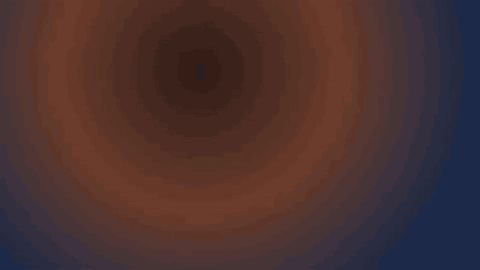
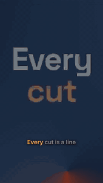

<p align="center"></p>

<h1 align="center">CutCraft</h1>

<p align="center">
  <b>Video editing as code.</b><br>
  A video is a TSX file. Clips are cut on transcript words and camera shots, not on seconds someone worked out by hand.
  The browser plays the file, an editor changes it, and Node exports it.
</p>

<p align="center">
  <a href="https://github.com/prefix-tree/cutcraft/actions/workflows/ci.yml"></a>
  <a href="https://www.npmjs.com/package/cutcraft"></a>
  <a href="https://prefix-tree.github.io/cutcraft/"></a>
  <a href="LICENSE"></a>
  
</p>

<p align="center">
  <a href="https://prefix-tree.github.io/cutcraft/">Documentation</a> ·
  <a href="https://prefix-tree.github.io/cutcraft/examples">Examples</a> ·
  <a href="https://prefix-tree.github.io/cutcraft/guide/introduction">Guide</a> ·
  <a href="https://prefix-tree.github.io/cutcraft/reference/elements/">Reference</a> ·
  <a href="CHANGELOG.md">Changelog</a>
</p>

---

```tsx
export const schema = z.object({ product: z.string(), accent: z.string() });
export const defaults = { product: "Shed", accent: "#ff5a1f" };

export default function Video({ product, accent }: z.infer<typeof schema>) {
  return (
    <Composition fps={30} width={1920} height={1080}>
      <Track id="main">
        <Clip id="hook" src="asset:founder" in="word:12" out="word:23.end" />
        <Transition id="x1" type="crossfade" duration={0.4} />
        <Clip id="broll" src="asset:product" in="shot:1" out="shot:1.end" fit="cover" />
      </Track>
      <Track id="overlays">
        <Title id="title" anchor="hook" at="word:14" duration={2.8} color={accent}>{product}</Title>
      </Track>
      <Track id="music" layout="free">
        <Audio id="bed" src="asset:music" start={0} duration="fill" volume={0.35} duck={{ under: "main", to: 0.15 }} />
      </Track>
    </Composition>
  );
}
```

Drag the end of `hook` in the timeline and one token in the file changes. The b-roll moves up behind it, the title
stays on the word it was timed to, and the music still runs to the end. Whoever opens the file next, a person or a
model, reads the edit as ordinary code.

<p align="center">
  
</p>
<p align="center">
  
  
  
</p>
<p align="center"><sub>Each one is a short TSX file exported by CutCraft: three.js and Motion, drawn by the browser engine. <a href="https://prefix-tree.github.io/cutcraft/examples">See them next to their files</a>.</sub></p>

## Why

Language models write code well and do arithmetic badly. A cut written as `8.43` seconds can land in the middle of a
word; a cut written as `word:12` lands on it. CutCraft lets the file say what it means (this word, that shot) and does
the math itself.

The timeline part of the file (tracks, clips, transitions, captions) uses elements with literal ids, so an editor
gesture can find the element it touched and change one value. Anything you draw on top can be free code: a
`<Layer>` holds any React, CSS, canvas or three.js you write.

## Free code: three.js, Motion, any React

You aren't limited to the built-in titles and graphics. A `<Layer>` takes any React component, with hooks, CSS 3D
transforms, filters, blend modes, a canvas or WebGL. `<Three>` and `<Motion>` bring [three.js](https://threejs.org)
and [Motion](https://motion.dev) onto the timeline:

```tsx
<Three id="cube" anchor="hook" at="word:14" duration={4}
  camera={{ position: [0, 0, 5], fov: 40 }} background="#101010"
  setup={({ scene, THREE }) => {
    const cube = new THREE.Mesh(new THREE.BoxGeometry(), new THREE.MeshNormalMaterial());
    scene.add(cube);
    return ({ time }) => { cube.rotation.set(time * 0.6, time, 0); };
  }}
/>

<Layer id="card" anchor="hook" at="word:20" duration={3}>
  <FlipCard front="Before" back="After" />   {/* your own component: useT() gives the time */}
</Layer>
```

All of it runs on the video's clock. Scrub backwards, seek, or play at 2×, and a three.js scene, a Motion sequence or a
CSS animation shows exactly the frame for that time. These layers are still timeline elements, so the editor moves,
trims and anchors them to words like everything else; only what they draw is up to you.

[`@cutcraft/graphics`](packages/graphics) has the host setup, and
[Free code](https://prefix-tree.github.io/cutcraft/guide/free-code) has the details.
The player draws all of this, and so does the export: a file with `<Three>` or `<Motion>` exports through the real
player in headless Chromium, frame by frame, with the same sound
([exporting](https://prefix-tree.github.io/cutcraft/guide/exporting#three-js-and-motion-the-browser-engine)).

## What's in it

| | |
|---|---|
| Elements | Tracks (a magnetic sequence or free placement), clips trimmed by seconds, words or shots, transitions, titles, shapes, SVG, stickers, built-in graphics, captions, markers, masks, adjustment layers, keyframes, speed ramps, freeze frames, nested compositions and multicam. `<Layer>` takes any React. |
| Time by meaning | `in="word:12"`, `out="shot:3.end"`, and overlays pinned to a word of the clip that says it (`anchor="hook" at="word:14"`), so cuts and graphics follow every trim. |
| Editing | 131 actions, each with validation and undo. Every edit is written back into the file as the smallest text change. |
| Lint | Checks the file before anything plays and reports props that are accepted but not drawn yet. |
| Player | A React `<Player>` and a framework-free `PlayerCore`: WebCodecs decoding through [mediabunny](https://mediabunny.dev), one canvas for footage, DOM for overlays, Web Audio as the clock, and frame-exact seeking. |
| Export | The same engine in Node, with no browser: MP4, WebM, MOV (ProRes), MP3 or WAV soundtracks, and PNG or JPEG stills. Files with `<Three>` or `<Motion>` export through the player in headless Chromium. A layout check reports overlays that leave the frame or the safe zone, or cover the captions or the subject, at their line in the file. |

## Quick start

Export a file from your project:

```sh
npm install cutcraft @cutcraft/kit react zod   # the CLI, and types for the file
npx cutcraft video.tsx --out video.mp4         # or .webm, .mov, .mp3, .wav
npx cutcraft video.tsx --still 2 --out poster.png
npx cutcraft video.tsx --check-layout --safe-zone tiktok
```

The [CLI reference](https://prefix-tree.github.io/cutcraft/reference/cli) lists every option, and
[A launch video, line by line](https://prefix-tree.github.io/cutcraft/guide/writing-files) walks through a 25-second
video.

To run the examples from this repository you need Node 22.19 or later, pnpm 10 (`corepack enable`), and `ffmpeg`
with the `drawtext` filter for the placeholder footage:

```sh
pnpm install
pnpm --filter @cutcraft/example-launch-recap gen   # placeholder footage
pnpm --filter @cutcraft/example-launch-recap dev   # http://localhost:5180
pnpm docs:dev                                      # the documentation site
```

## Packages

| Package | What it is |
|---|---|
| [`cutcraft`](packages/cli) | The command line: export a file to video, audio or a still, or check its layout. |
| [`@cutcraft/kit`](packages/kit) | The elements, time references, resolver, editor actions, source edits and lint. No DOM. |
| [`@cutcraft/player`](packages/player) | The browser player and the React `<Player>`. |
| [`@cutcraft/render`](packages/render) | Export in Node, as a library: `loadVideo` and `renderVideo`. |
| [`@cutcraft/graphics`](packages/graphics) | 34 ready-made `<Graphic>` kinds (arrows, callouts, lower thirds, data graphics, backgrounds, icons), and three.js and Motion on the video's clock for `<Three>` and `<Motion>`. |

The repository also holds [eight recipes](https://prefix-tree.github.io/cutcraft/recipes/) (complete files for common
videos, each tested) and [the worked example](examples/launch-recap).

## Status

| | |
|---|---|
| Works | Resolving, every editor action with undo, writing edits back to the file, lint. Playback with seek, rate and loop; crossfade, dip, wipe, slide and push transitions; keyframes on transforms, effects, colour and sound; speed ramps and freeze frames with their audio; masks, overlays, captions and ducking. Export with frame-exact pictures, and the layout check. |
| Partial | Other transition types draw as a crossfade. Effects with no CSS filter (vignette and grain do draw), colour wheels, curves and LUTs, matte masks, audio effects, pitch correction and 3D transforms are accepted but not drawn yet, and the lint says so ([what renders](https://prefix-tree.github.io/cutcraft/reference/rendering)). The Node export draws a `<Layer>` with a subset of CSS; `--engine browser` draws all of it. |

## Roadmap

1. One export engine. The browser engine draws everything the player does but is slower without a GPU; once it
   matches the Node engine's speed and passes its parity tests, it draws every file.
2. Footage in free code. `useClipFrame(clipId)` will hand a clip's current frame to your code for CSS 3D or a shader,
   and a `<Transition>` will take your own component along with its progress.
3. An effects library: GPU effects for clips and layers, with options you can animate and an inspector for each.
   LUTs, curves, colour wheels and levels, chroma key, matte masks, glow, sharpen, light leaks, film grain, chromatic
   aberration, zoom blur and glitch, plus zoom, glitch and 3D transitions. Most of what is accepted but not drawn
   today moves here, and the preview and the export draw it the same way.
4. An open editor package with the timeline, inspector and preview gestures over the action set.

## Contributing

[CONTRIBUTING.md](CONTRIBUTING.md) covers setup, where things live, and how to add an element or an action. Please
report security issues privately as [SECURITY.md](SECURITY.md) describes, and follow the
[code of conduct](CODE_OF_CONDUCT.md).

## License

[MIT](LICENSE).
