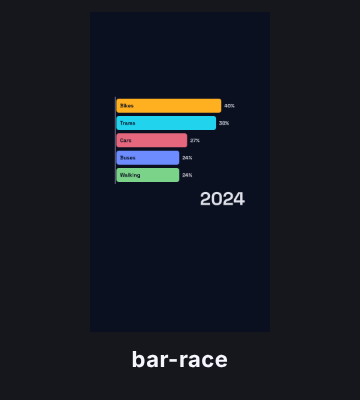
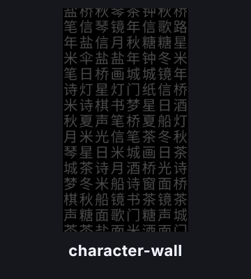
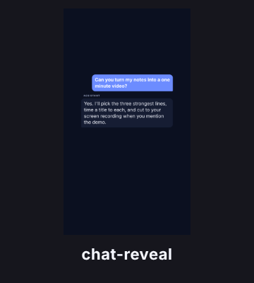
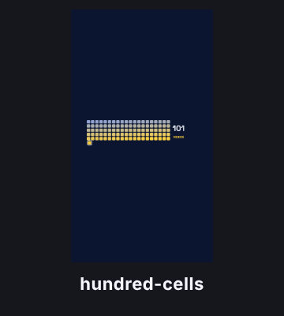
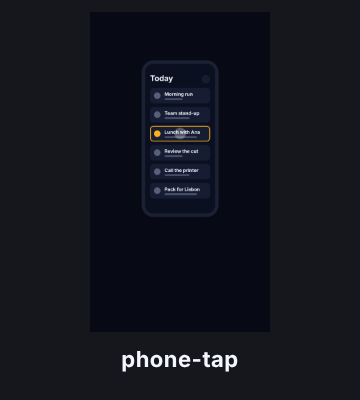
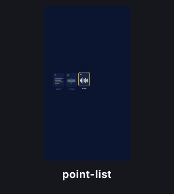
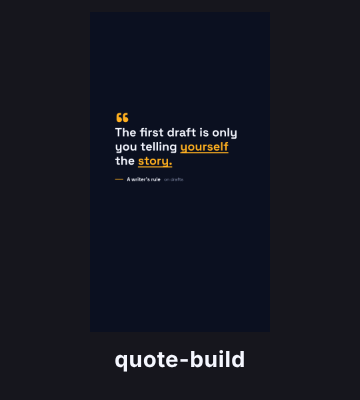
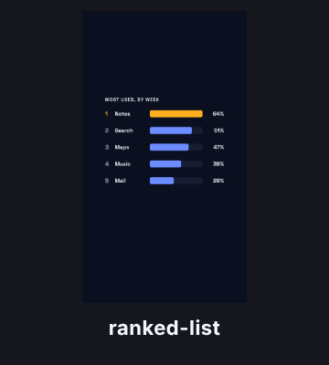
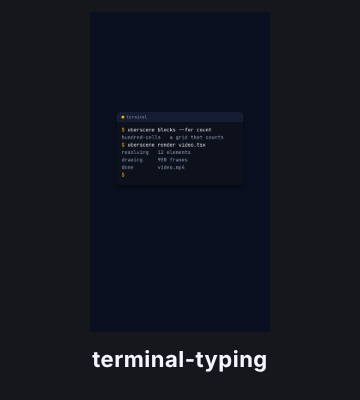

# Blocks

A block is a scene that is already made: a chat that types its reply, a terminal that runs commands, a ranking that
reorders, a quote that builds word by word. It is bigger than a [component](/reference/components/) and smaller than a
video. You place it on a track, set what it says and how it looks, and it plays on the video's clock like any free
code. Nine ship with the CLI, so they work offline and match the version you have installed.

**See it in:** [From notes to a cut](/examples/notes-to-cut), a short made of five placements of four blocks.
[An interview that changes layout](/examples/hundred-videos) and [Snake heart](/examples/snake-heart) use blocks too.

## What a block is

A block is one file: a React component, its props `schema` with a label for every value, its `defaults`, and a `meta`
that says what it is for, when not to use it and how long it takes. Its colours and fonts default to the video's theme
tokens (`$accent`, `$heading`), so a block takes on the look of the video it is placed in. It names its parts
(`data-name`), so [the layout check](/guide/checking#check-the-layout) and `uberscene where` report them.

A block reads its Layer's clock. Given more time than its natural length, it holds its last state. The props that time
its moments are listed as its beats: most (`changes`, `after`, `start`) are seconds since its Layer started, and a
prop called `at` is seconds of the video, which is what a narration's cue gives.

## Find one by its job

```sh
npx uberscene blocks --for "reorder" --aspect 9:16
npx uberscene blocks --sheet blocks.png
```

The list gives each block's title, what it does, when to use it and when not, the props that time it, and the line that
places it. `--for` keeps the blocks whose description mentions every word given; `--aspect` keeps those laid out for a
frame shape. `--sheet` pastes their previews into one picture, numbered as listed, to choose by looking. `--json`
gives the same list for a program.

## Add it to a video

```sh
npx uberscene blocks add ranked-list --into video.tsx --track graphics --at hook@word:14 --duration 6
```

This copies the block into the project as `blocks/ranked-list.tsx`, beside `uberscene.json`, and records its version
and a hash of its text in the manifest. With `--into`, it also imports the component in the video and adds a Layer
holding it at the end of the track:

```tsx
import { RankedList } from "./blocks/ranked-list";

<Layer id="ranked-list" anchor="hook" at="word:14" duration={6}>
  <RankedList />
</Layer>
```

`--at` takes seconds (a `start`), an element (`anchor`), or a word of a clip (`hook@word:14`, an `anchor` and an
`at`). `--duration` defaults to the block's length and `--id` to its name. The video is read back after the change; if
it does not load or has new errors, it is put back as it was.

## Tune it where it is placed

What changes from one use to the next is the props on the tag, not the copy. Two placements of one block can say
different things without two files:

```tsx
<Layer id="check" start={20.2} duration={7.8}>
  <RankedList
    title="STILL WATCHING, BY SCENE"
    rows={[
      { label: "Demo", values: [52, 61, 74] },
      { label: "Problem", values: [70, 64, 58] },
    ]}
    changes={[1.6, 3.6]}
  />
</Layer>
```

In the editor these are the Layer's handles: each prop of the schema is a control, labelled by its description, and
the editor writes the value back to the tag. A colour, a font or an image prop gets the control for its kind. An agent
reads the same labels from `uberscene inspect --json`.

## Keep it up to date

```sh
npx uberscene blocks update
```

A copy nobody has edited (its text still matches the hash in the manifest) is replaced with the version that ships
with your CLI, and its record is updated. A copy you have edited is left alone and its diff is printed, so you can see
what a newer block would change; `--force` replaces it anyway. The copy is yours to edit: the comment at the top of
each block says what is meant to change, what is safe to edit and what holds its motion together.

## The catalogue

<!-- catalogue: generated by scripts/gen-docs.ts from blocks/; do not edit -->

<div class="cc-cards cc-blocks">
<div><a class="cc-card" href="#bar-race"><span class="cc-card-title"><code>bar-race</code></span><span class="cc-card-text">Bars grow and overtake each other period by period, the leaders shown, the period named beside them.</span></a></div>
<div><a class="cc-card" href="#character-wall"><span class="cc-card-title"><code>character-wall</code></span><span class="cc-card-text">A frame-filling grid of characters, each changing at its own pace, and all at once on the moments given.</span></a></div>
<div><a class="cc-card" href="#chat-reveal"><span class="cc-card-title"><code>chat-reveal</code></span><span class="cc-card-text">A chat exchange: a question slides up, a reply shows dots, then types in word by word.</span></a></div>
<div><a class="cc-card" href="#hundred-cells"><span class="cc-card-title"><code>hundred-cells</code></span><span class="cc-card-text">A grid of cells fills one by one, each a shade nearer the accent, with the count beside it; then one more arrives.</span></a></div>
<div><a class="cc-card" href="#phone-tap"><span class="cc-card-title"><code>phone-tap</code></span><span class="cc-card-text">A phone with a simple screen; a fingertip presses given points, each with a ripple, and selects the row it hits.</span></a></div>
<div><a class="cc-card" href="#point-list"><span class="cc-card-title"><code>point-list</code></span><span class="cc-card-text">A row of tiles, one per point, each with a small drawing and a label, lit in turn as each point is named.</span></a></div>
<div><a class="cc-card" href="#quote-build"><span class="cc-card-title"><code>quote-build</code></span><span class="cc-card-text">A quotation arrives word by word, its key words stressed in the accent, then the name of who said it.</span></a></div>
<div><a class="cc-card" href="#ranked-list"><span class="cc-card-title"><code>ranked-list</code></span><span class="cc-card-text">Rows ranked by their values; when the values change, the rows slide to their new places.</span></a></div>
<div><a class="cc-card" href="#terminal-typing"><span class="cc-card-title"><code>terminal-typing</code></span><span class="cc-card-text">A terminal window: commands type in after a prompt, and their output appears line by line.</span></a></div>
</div>

### Bar race {#bar-race}

Bars grow and overtake each other period by period, the leaders shown, the period named beside them.

- **Use it for:** how a ranking changed over years or months; a race between options over time; show who rose and who fell.
- **Not for:** two or three steps only: use ranked-list; values that never cross: a plain bar chart says it.
- **Goes with:** `ranked-list`, `narrate`.
- **Length:** 5.5 s with its defaults; given longer, it holds its last state. **Frame:** 9:16. **Timed by:** `start`.

| prop | kind | default | what it is |
|---|---|---|---|
| `series` | other | 6 items | The series that race |
| `periods` | other | 6 items | The name of each period, such as a year |
| `start` | number | `0.5` | Seconds since the layer started at which the race begins |
| `every` | number | `0.9` | Seconds each period lasts |
| `show` | number | `5` | How many bars are shown, the leaders |
| `suffix` | text | `"%"` | Written after every value |
| `x` | number | `150` | Left edge of the race, in pixels |
| `y` | number | `520` | Top edge of the race, in pixels |
| `width` | number | `780` | Width of the longest bar's lane, in pixels |
| `barHeight` | number | `84` | Height of a bar, in pixels |
| `gap` | number | `20` | Pixels between bars |
| `palette` | other | 6 items | Colours the bars take in turn, unless a series names its own |
| `ink` | color | `"$text"` | Colour of the names, values and the period |
| `muted` | color | `"$muted"` | Colour of the axis line |
| `font` | font | `"$heading"` | Font of the race |
| `weight` | number | `700` | Weight of the names and values |

```sh
npx uberscene blocks add bar-race --into video.tsx --track graphics --at 2
```

### Character wall {#character-wall}

A frame-filling grid of characters, each changing at its own pace, and all at once on the moments given.

- **Use it for:** a living ground behind a game, a word or a phrase; a busy texture of letters or signs; a beat the whole frame reacts to.
- **Not for:** text that must be read: the wall is texture, not words; footage under it: it covers the frame.
- **Goes with:** `narrate`, `grid`.
- **Length:** 6 s with its defaults; given longer, it holds its last state. **Frame:** 9:16. **Timed by:** `changeAt`, `dim`.

| prop | kind | default | what it is |
|---|---|---|---|
| `chars` | text | `"春夏秋冬日月星光年梦声歌诗画书茶酒灯窗桥路城门钟船信纸笔琴棋伞镜糖盐米面"` | The characters the wall is made of; use a font that has them |
| `columns` | number | `8` | Cells across the frame |
| `rows` | number | `15` | Rows of cells, centred top to bottom; rows past the frame run off it |
| `color` | color | `"$muted"` | Colour of the characters |
| `background` | color | `"$background"` | Colour behind them |
| `font` | font | `"$heading"` | Font of the characters |
| `weight` | number | `400` | Weight of the characters |
| `scale` | number | `0.9` | A character's size, as a share of its cell |
| `pace` | number | `1` | How slowly the characters change: 1 is the default pace, 2 half as fast |
| `changeAt` | other | 0 items | Seconds since the layer started at which every character changes at once |
| `dim` | other, optional |  | When the wall fades back, to leave room for what is on top |

```sh
npx uberscene blocks add character-wall --into video.tsx --track graphics --at 2
```

### Chat reveal {#chat-reveal}

A chat exchange: a question slides up, a reply shows dots, then types in word by word.

- **Use it for:** show what someone asked and what came back; a product demo of a prompt and its answer; a conversation told as messages.
- **Not for:** a real app's screen must be shown: record it instead; long replies: they outgrow the frame.
- **Goes with:** `terminal-typing`, `phone-tap`, `narrate`.
- **Length:** 5.5 s with its defaults; given longer, it holds its last state. **Frame:** 9:16. **Timed by:** `messages`.

| prop | kind | default | what it is |
|---|---|---|---|
| `messages` | other | 2 items | The messages, in order |
| `thinking` | number | `0.9` | Seconds of dots before a reply starts typing |
| `wordsPerSecond` | number | `7` | How fast a reply types, in words a second |
| `label` | text | `"ASSISTANT"` | A small line above the replies, such as the assistant's name; empty for none |
| `x` | number | `150` | Left edge of the column, in pixels |
| `y` | number | `560` | Top edge of the column, in pixels |
| `width` | number | `780` | Width of the column, in pixels |
| `size` | number | `40` | Size of the text, in pixels |
| `person` | color | `"$primary"` | Colour of the person's bubbles |
| `onPerson` | color | `"$onPrimary"` | Colour of the text in the person's bubbles |
| `reply` | color | `"$surface"` | Colour of the reply bubbles |
| `ink` | color | `"$text"` | Colour of the text in the reply bubbles |
| `muted` | color | `"$muted"` | Colour of the dots and the label |
| `font` | font | `"$body"` | Font of the messages |

```sh
npx uberscene blocks add chat-reveal --into video.tsx --track graphics --at 2
```

### Hundred cells {#hundred-cells}

A grid of cells fills one by one, each a shade nearer the accent, with the count beside it; then one more arrives.

- **Use it for:** count up to a big number; show a hundred tries, days or videos; make progress visible.
- **Not for:** the number is a measurement, not a count of things: use CountUp; fewer than ten things.
- **Goes with:** `point-list`, `narrate`.
- **Length:** 4 s with its defaults; given longer, it holds its last state. **Frame:** 9:16. **Timed by:** `fill`, `next`.

| prop | kind | default | what it is |
|---|---|---|---|
| `total` | number | `100` | How many cells fill |
| `columns` | number | `20` | Cells to a row |
| `label` | text | `"VIDEOS"` | The word under the count |
| `extra` | boolean | `true` | Whether one more cell arrives after the rest, ringed |
| `fill` | other | `{"after":0.3,"over":2}` | When the cells fill |
| `next` | other | `{"after":3.4,"over":0.3}` | When the extra cell arrives |
| `x` | number | `120` | Left edge of the grid, in pixels |
| `y` | number | `840` | Top edge of the grid, in pixels |
| `cell` | number | `26` | A cell's size, in pixels |
| `gap` | number | `6` | Pixels between cells |
| `accent` | color | `"$accent"` | Colour of the last cells, the extra cell and the label |
| `from` | color | `"#8fa0d0"` | Colour of the first cell |
| `dim` | color | `"$surface"` | Colour of a cell not yet filled |
| `ink` | color | `"$text"` | Colour of the count and of the ring |
| `font` | font | `"$heading"` | Font of the count and the label |
| `weight` | number | `800` | Weight of the count and the label |

```sh
npx uberscene blocks add hundred-cells --into video.tsx --track graphics --at 2
```

### Phone tap {#phone-tap}

A phone with a simple screen; a fingertip presses given points, each with a ripple, and selects the row it hits.

- **Use it for:** show where to tap in an app; a step of a mobile flow; point at one item of a list on a phone.
- **Not for:** a real app must be shown exactly: record its screen; many screens in a row: cut between recordings.
- **Goes with:** `chat-reveal`, `point-list`, `narrate`.
- **Length:** 5 s with its defaults; given longer, it holds its last state. **Frame:** 9:16. **Timed by:** `taps`.

| prop | kind | default | what it is |
|---|---|---|---|
| `title` | text | `"Today"` | The screen's heading |
| `rows` | other | 6 items | The rows of the list on the screen |
| `image` | text, optional |  | A picture to show on the screen instead of the title and rows, as a URL |
| `taps` | other | 2 items | Where and when the finger presses |
| `x` | number | `310` | Left edge of the phone, in pixels |
| `y` | number | `290` | Top edge of the phone, in pixels |
| `height` | number | `940` | Height of the phone, in pixels; its width follows |
| `body` | color | `"#1b2133"` | Colour of the phone's frame |
| `screen` | color | `"$background"` | Colour of the screen |
| `row` | color | `"$surface"` | Colour of a row |
| `ink` | color | `"$text"` | Colour of the title and the rows' text |
| `muted` | color | `"$muted"` | Colour of the rows' second lines |
| `accent` | color | `"$accent"` | Colour of a selected row's edge and of the ripple |
| `font` | font | `"$body"` | Font of the screen |

```sh
npx uberscene blocks add phone-tap --into video.tsx --track graphics --at 2
```

### Point list {#point-list}

A row of tiles, one per point, each with a small drawing and a label, lit in turn as each point is named.

- **Use it for:** a list of three to six points named one after another; steps, ingredients or improvements as they are said.
- **Not for:** more than six points: they will not fit a row; points that need a sentence each: use a card.
- **Goes with:** `hundred-cells`, `narrate`.
- **Length:** 6 s with its defaults; given longer, it holds its last state. **Frame:** 9:16. **Timed by:** `points`.

| prop | kind | default | what it is |
|---|---|---|---|
| `points` | other | 5 items | The points, in the order they are named |
| `x` | number | `120` | Left edge of the row, in pixels |
| `y` | number | `830` | Top edge of the row, in pixels |
| `width` | number | `140` | A tile's width, in pixels |
| `height` | number | `170` | A tile's height, in pixels |
| `gap` | number | `17` | Pixels between tiles |
| `accent` | color | `"$accent"` | Colour of the lit tile's edge, the tags and the drawings' highlights |
| `ink` | color | `"$text"` | Colour of a lit tile's drawing and label |
| `faded` | color | `"#7f8bb3"` | Colour a drawing and label dim to once the next point arrives |
| `tile` | color | `"$surface"` | Colour of the tiles |
| `font` | font | `"$heading"` | Font of the tags and labels |
| `weight` | number | `800` | Weight of the tags and labels |

```sh
npx uberscene blocks add point-list --into video.tsx --track graphics --at 2
```

### Quote build {#quote-build}

A quotation arrives word by word, its key words stressed in the accent, then the name of who said it.

- **Use it for:** a line worth reading on screen; a testimonial or a quote from an interview; the thesis of a video.
- **Not for:** more than about thirty words: split it; words that must match a voice exactly: time them with captions.
- **Goes with:** `narrate`, `chat-reveal`.
- **Length:** 5 s with its defaults; given longer, it holds its last state. **Frame:** 9:16. **Timed by:** `start`.

| prop | kind | default | what it is |
|---|---|---|---|
| `text` | text | `"The first draft is only you telling …` | The quotation, without quote marks |
| `stress` | other | 2 items | Words to stress, as written in the quote; punctuation around them is ignored |
| `author` | text | `"A writer's rule"` | Who said it; empty for none |
| `role` | text | `"on drafts"` | A line under the name, such as a title or a year; empty for none |
| `start` | number | `0.6` | Seconds since the layer started at which the first word arrives |
| `wordsPerSecond` | number | `3.2` | How fast the words arrive |
| `x` | number | `150` | Left edge of the quote, in pixels |
| `y` | number | `600` | Top edge of the quote, in pixels |
| `width` | number | `780` | Width of the quote, in pixels |
| `size` | number | `72` | Size of the quote's words, in pixels |
| `ink` | color | `"$text"` | Colour of the words |
| `accent` | color | `"$accent"` | Colour of the stressed words, their marks and the opening mark |
| `muted` | color | `"$muted"` | Colour of the role line |
| `font` | font | `"$heading"` | Font of the quote |
| `weight` | number | `700` | Weight of the quote's words |

```sh
npx uberscene blocks add quote-build --into video.tsx --track graphics --at 2
```

### Ranked list {#ranked-list}

Rows ranked by their values; when the values change, the rows slide to their new places.

- **Use it for:** a ranking that changes: before and after, week by week; show who overtakes whom; a top five whose order is the story.
- **Not for:** a race over many periods: use bar-race; values that do not change: a plain list reads faster; more than eight rows.
- **Goes with:** `bar-race`, `hundred-cells`, `narrate`.
- **Length:** 5 s with its defaults; given longer, it holds its last state. **Frame:** 9:16. **Timed by:** `changes`.

| prop | kind | default | what it is |
|---|---|---|---|
| `title` | text | `"MOST USED, BY WEEK"` | The line above the ranking; empty for none |
| `rows` | other | 5 items | The rows, in any order: they are placed by their values |
| `changes` | other | 2 items | Seconds since the layer started at which the values move to their next step |
| `over` | number | `0.7` | How long a change takes, in seconds |
| `suffix` | text | `"%"` | Written after every value, such as % or k |
| `decimals` | number | `0` | Digits after the point in the values |
| `x` | number | `150` | Left edge of the ranking, in pixels |
| `y` | number | `560` | Top edge of the ranking, in pixels |
| `width` | number | `780` | Width of the ranking, in pixels |
| `rowHeight` | number | `92` | Height of a row, in pixels |
| `gap` | number | `18` | Pixels between rows |
| `accent` | color | `"$accent"` | Colour of the leader's bar and place |
| `bar` | color | `"$primary"` | Colour of the other bars |
| `track` | color | `"$surface"` | Colour behind each bar |
| `ink` | color | `"$text"` | Colour of the names, the values and the title |
| `muted` | color | `"$muted"` | Colour of the places other than the first |
| `font` | font | `"$heading"` | Font of the whole ranking |
| `weight` | number | `700` | Weight of the names and values |

```sh
npx uberscene blocks add ranked-list --into video.tsx --track graphics --at 2
```

### Terminal typing {#terminal-typing}

A terminal window: commands type in after a prompt, and their output appears line by line.

- **Use it for:** show a command and what it does; a developer tool in action; install or run steps.
- **Not for:** output longer than the window: it is not scrolled; a real tool's exact screen must be shown.
- **Goes with:** `chat-reveal`, `narrate`.
- **Length:** 5 s with its defaults; given longer, it holds its last state. **Frame:** 9:16. **Timed by:** `steps`.

| prop | kind | default | what it is |
|---|---|---|---|
| `steps` | other | 2 items | The commands, in order |
| `prompt` | text | `"$"` | What comes before each command, such as $ or > |
| `title` | text | `"terminal"` | The window's title; empty for none |
| `lettersPerSecond` | number | `22` | How fast a command types |
| `lineGap` | number | `0.28` | Seconds between output lines |
| `x` | number | `160` | Left edge of the window, in pixels |
| `y` | number | `600` | Top edge of the window, in pixels |
| `width` | number | `760` | Width of the window, in pixels |
| `height` | number | `440` | Height of the window, in pixels |
| `size` | number | `30` | Size of the text, in pixels |
| `window` | color | `"#0d111c"` | Colour of the window |
| `bar` | color | `"$surface"` | Colour of the title bar |
| `ink` | color | `"$text"` | Colour of the commands |
| `output` | color | `"$muted"` | Colour of the output |
| `accent` | color | `"$accent"` | Colour of the prompt and the cursor |
| `font` | font | `"$mono"` | Font of the terminal; a monospaced one |

```sh
npx uberscene blocks add terminal-typing --into video.tsx --track graphics --at 2
```

<!-- end of catalogue -->

## Next

- [Free code](/guide/free-code): what a block is made of, and how to write your own.
- [Checking a cut](/guide/checking): the layout check and `where`, which report a block's parts.
- [The CLI](/reference/cli#blocks): every option of `blocks`, `blocks add` and `blocks update`.
